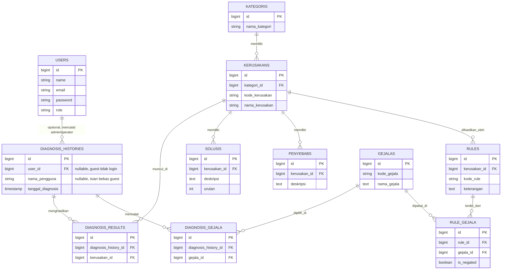

# ERD — Sistem Pakar Diagnosa Kerusakan Laptop

Skema ini turunan langsung dari PRD section 5.8 (Database) dan section 5.3 (Forward Chaining), plus struktur `knowledge-base.md`. Prinsip: rule dan gejala tersimpan di database (bukan hardcode), dukung relasi many-to-many gejala↔rule, dan riwayat diagnosis tersimpan penuh (gejala yang dipilih + hasil).

---

## 1. Diagram Relasi (Mermaid ERD)

---

## 2. Detail Tabel

### `users`
Admin sistem. Guest tidak butuh akun.

| Kolom | Tipe | Keterangan |
|---|---|---|
| id | bigint, PK | |
| name | varchar(100) | |
| email | varchar(100), unique | |
| password | varchar(255) | hashed (bcrypt) |
| role | enum('admin') | siap diperluas kalau nanti ada role teknisi |
| timestamps | | created_at, updated_at |

### `kategoris`
Hardware / Software.

| Kolom | Tipe | Keterangan |
|---|---|---|
| id | bigint, PK | |
| nama_kategori | varchar(50) | "Hardware" / "Software" |
| timestamps | | |

### `gejalas`
Master gejala (fakta awal Forward Chaining).

| Kolom | Tipe | Keterangan |
|---|---|---|
| id | bigint, PK | |
| kode_gejala | varchar(10), unique | contoh: G01 |
| nama_gejala | text | |
| timestamps | | |

### `kerusakans`
Master kerusakan (fakta hasil).

| Kolom | Tipe | Keterangan |
|---|---|---|
| id | bigint, PK | |
| kategori_id | bigint, FK → kategoris.id | |
| kode_kerusakan | varchar(10), unique | contoh: K01 |
| nama_kerusakan | varchar(150) | |
| timestamps | | |

### `penyebabs`
Dipisah dari `kerusakans` biar satu kerusakan bisa punya beberapa penyebab tanpa comma-separated string di satu kolom.

| Kolom | Tipe | Keterangan |
|---|---|---|
| id | bigint, PK | |
| kerusakan_id | bigint, FK → kerusakans.id | |
| deskripsi | text | |
| timestamps | | |

### `solusis`
Sama alasannya dengan `penyebabs`, plus `urutan` untuk solusi bertahap (coba solusi 1 dulu, baru 2).

| Kolom | Tipe | Keterangan |
|---|---|---|
| id | bigint, PK | |
| kerusakan_id | bigint, FK → kerusakans.id | |
| deskripsi | text | |
| urutan | tinyint | default 1 |
| timestamps | | |

### `rules`
Satu kerusakan bisa punya lebih dari satu rule (kombinasi gejala berbeda bisa mengarah ke kerusakan yang sama).

| Kolom | Tipe | Keterangan |
|---|---|---|
| id | bigint, PK | |
| kerusakan_id | bigint, FK → kerusakans.id | |
| kode_rule | varchar(10), unique | contoh: R01 |
| keterangan | text, nullable | catatan admin |
| timestamps | | |

### `rule_gejala` (pivot, many-to-many)
Jantung mesin Forward Chaining. Satu rule butuh beberapa gejala; satu gejala bisa dipakai di banyak rule.

| Kolom | Tipe | Keterangan |
|---|---|---|
| id | bigint, PK | |
| rule_id | bigint, FK → rules.id | |
| gejala_id | bigint, FK → gejalas.id | |
| is_negated | boolean, default false | true kalau rule butuh gejala ini **tidak muncul** (dukung logika `NOT` seperti di knowledge-base.md) |
| timestamps | | |

> Kalau mesin Forward Chaining versi awal cuma dukung `AND` murni tanpa `NOT`, kolom `is_negated` tetap boleh dibikin sekarang (default false, tidak dipakai) biar gak perlu migration ulang kalau nanti logic-nya diperluas.

### `diagnosis_histories`
Satu baris = satu sesi diagnosis oleh guest/pengguna.

| Kolom | Tipe | Keterangan |
|---|---|---|
| id | bigint, PK | |
| user_id | bigint, FK → users.id, nullable | biasanya null (guest) |
| nama_pengguna | varchar(100), nullable | isian bebas kalau guest mau isi nama |
| tanggal_diagnosis | timestamp | |
| timestamps | | |

### `diagnosis_gejala` (pivot)
Gejala apa saja yang dipilih pengguna di satu sesi diagnosis.

| Kolom | Tipe | Keterangan |
|---|---|---|
| id | bigint, PK | |
| diagnosis_history_id | bigint, FK → diagnosis_histories.id | |
| gejala_id | bigint, FK → gejalas.id | |
| timestamps | | |

### `diagnosis_results`
Kerusakan apa saja yang cocok dari satu sesi diagnosis (bisa lebih dari satu kerusakan match).

| Kolom | Tipe | Keterangan |
|---|---|---|
| id | bigint, PK | |
| diagnosis_history_id | bigint, FK → diagnosis_histories.id | |
| kerusakan_id | bigint, FK → kerusakans.id | |
| timestamps | | |

---

## 3. Alur Query Forward Chaining (ringkas)

1. Simpan gejala yang dipilih guest ke `diagnosis_gejala`.
2. Ambil semua `rules` beserta relasi `rule_gejala`.
3. Untuk tiap rule: cek apakah **semua** `gejala_id` dengan `is_negated = false` ada di gejala yang dipilih, DAN **semua** `gejala_id` dengan `is_negated = true` **tidak ada** di gejala yang dipilih.
4. Rule yang lolos → ambil `kerusakan_id`-nya → simpan ke `diagnosis_results`.
5. Kalau ada lebih dari satu kerusakan match, tampilkan semua dengan penyebab & solusi masing-masing (join ke `penyebabs` dan `solusis`).

Taruh logic ini di Service class (`app/Services/ForwardChainingService.php`), bukan di controller — sesuai PRD section 6.4.

---

## 4. Kenapa Skema Ini Bentuknya Begini

- **`penyebabs` dan `solusis` dipisah dari `kerusakans`**, bukan jadi kolom text panjang, karena satu kerusakan realistis punya lebih dari satu penyebab/solusi (lihat isi `knowledge-base.md` — tiap kerusakan ada beberapa poin). Pisah tabel = gampang di-CRUD satu-satu dari admin panel, sesuai PRD section 5.7.
- **`rules` dan `kerusakans` dipisah** (bukan rule punya kolom nama_kerusakan langsung) karena satu kerusakan bisa dicapai lewat kombinasi gejala berbeda (contoh K05 di knowledge-base.md dicapai lewat R02 dan R12). Kalau digabung, gak bisa punya banyak rule per kerusakan.
- **`diagnosis_gejala` dan `diagnosis_results` dipisah** biar riwayat diagnosis (PRD 5.6) bisa direkonstruksi penuh: gejala apa yang dipilih user, DAN kerusakan apa saja yang keluar — dua hal beda yang keduanya wajib tersimpan.
- **`is_negated` di `rule_gejala`** disiapkan dari awal karena `knowledge-base.md` yang kubuat sebelumnya butuh logika NOT untuk bedain gejala yang overlap. Kalau Forward Chaining kamu ternyata versi PRD murni `AND` tanpa `NOT`, kolom ini tinggal didiamkan (default false) — lebih murah drop rule daripada migration ulang nambah kolom pas development sudah jalan.

Metodologi final: murni Forward Chaining rule matching, tanpa Certainty Factor — skema di atas sudah disesuaikan (kolom `persentase_keyakinan` dihapus).
